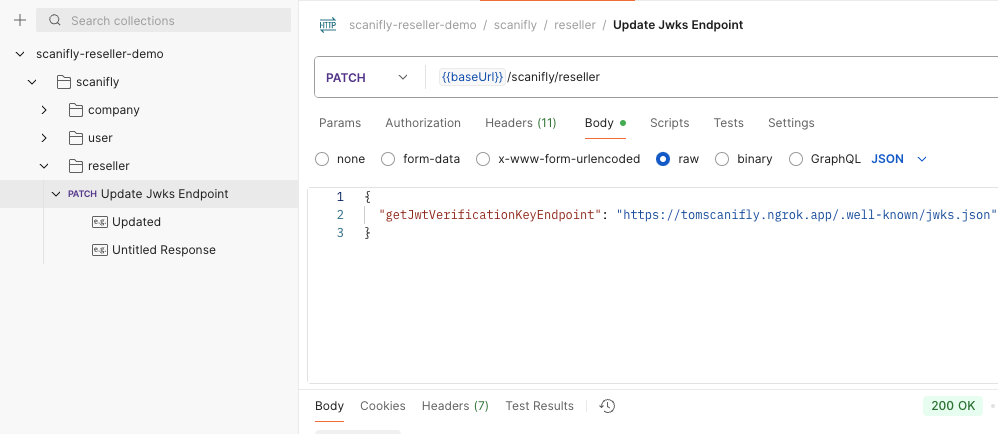

## Scanifly Reseller Demo Server

This is a NodeJS/Express HTTP server that will allow you to quickly test the Scanifly reseller APIs and see how to get your JWKS setup to be able to sign JWT's that Scanifly can then validate and use to authenticate your users into it's system.

## Setup & Running Locally

### Install Dependencies 
Clone the repository:
```bash
git clone git@github.com:Scanifly/reseller-demo-server.git
cd reseller-demo-server
```

### Postman

Inside the `app/routes/swagger.json` file is the openapi schema that you can import into Postman to easily test the APIs this server exposes.

### Setting Up Environment Variables

Copy the environment variable template file from `_env` to `.env`

```bash
cp _env .env
```

Your JWKS algorithm must be RS256 and you private key exported in PEM format.

If you do not already have a JWKS you can generate one for testing [here](https://jwkset.com/generate)

Place your private key in the `JWKS_PRIVATE_KEY` field in the .env.

Take the public key and put it in the `/app/jwks.json` file inside the `keys` array.

Place your key ID in the `JWKS_KEY_ID` field in the .env

The `SCANIFLY_API_KEY` value in your .env must be an API key created by an `admin` of your Scanifly reseller account so that it can interact with the reseller APIs. See [Getting a Scanifly API Key](#getting-a-scanifly-api-key) below.

### Getting a Scanifly API Key

This server authenticates to Scanifly with an API key instead of an email/password login. The key acts on behalf of the admin user who created it.

1. Log in to the [Scanifly portal](https://portal.scanifly.com) as an **admin** of your reseller company (only admins can manage access tokens).
2. Open **Account → Access Tokens** (or go directly to `https://portal.scanifly.com/account/access-tokens`).
3. Create a new token: give it a recognizable name (e.g. `reseller-demo-server`) and optionally an expiration date.
4. Copy the token when it is displayed and store it somewhere safe — treat it like a password.
5. Paste it into the `SCANIFLY_API_KEY` field in your `.env`.

The server sends the key in the `x-api-token` header for reseller-level calls (creating companies and users, buying credits, setting your JWKS endpoint). Calls made on behalf of one of your users (creating projects and designs, listing them) instead send a JWT for that user, signed with your JWKS private key, as `Authorization: Bearer <jwt>`.

If a request fails with `401 Unauthorized`, the key may have expired or been revoked — generate a new one from the same Access Tokens page.

### Scanifly API routes used

Every call this server makes goes to a documented route under Scanifly's public `/api/v1` API, with one of two credentials:

| This server | Scanifly route | Auth |
| --- | --- | --- |
| (first use, then cached) | `GET /api/v1/companies/current` to look up your reseller company ID | API key |
| `POST /scanifly/company` | `POST /api/v1/reseller/company` | API key |
| `POST /scanifly/user` | `POST /api/v1/reseller/user` | API key |
| `POST /scanifly/credit` | `POST /api/v1/reseller/subscription/credits` | API key |
| `PATCH /scanifly/reseller` | `PATCH /api/v1/reseller` | API key |
| `GET /scanifly/projects` | `GET /api/v1/projects` | User JWT |
| `POST /scanifly/project` | `POST /api/v1/projects` | User JWT |
| `GET /scanifly/projects/{id}/designs` | `GET /api/v1/designs/{projectId}` | User JWT |
| `POST /scanifly/design` | `POST /api/v1/designs/{projectId}` | User JWT |
| `POST /scanifly/module-library` | `POST /api/v1/module-library` (plus `GET /api/v1/companies/current/members` to find the user's ID when you don't pass `scaniflyUserId`) | User JWT |
| `POST /scanifly/3dUrl`, `POST /scanifly/design-settings-embed` | none: the server signs a user JWT for the embed | — |

A user JWT acts as that user, so projects and designs land in the user's own Scanifly company. You don't pass a company ID for them.

### Running Locally

####
This app is dockerized and can be run in a container by using the commands in the Makefile

```bash
make build-up
```

Alternatively if you want to modify the code and see your changes in real time you can run it locally with nodemon.

#### Prerequisites
- **Node.js** (v18+ recommended)
- **Yarn** (this repo uses Yarn 3.6.4)

If you don’t already have Yarn:
```bash
npm install -g yarn
```

To run the code locally with nodemon:

```bash
yarn install && yarn local
```
#### Configuring JWKS Validation

Scanifly needs to know the endpoint to reach out to validate a JWT against your JWKS public key.

That endpoint must be accessible via HTTPS.

A quick way to serve up this local node server via HTTPS is using [ngrok](https://ngrok.com/).

It does require a paid account to be able to serve via HTTPS.

Assuming you have a paid account and have a static domain on ngrok. 

On Mac you serve this demo server via that endpoint:
```bash
ngrok http --url=your_ngrok_domain 3001
```

Once you have your HTTPS URL you need to tell Scanifly to use that endpoint to validate your JWTs.

The PATCH scanifly/reseller endpoint can be used to accomplish that.



### Getting A 3D URL

If the user already has a companyId and userId you can skip to step 3.

1. Create a company in Scanifly
2. Create a user in Scanifly to associate with the company
3. Create a project in Scanifly for a given address
4. Create a design in Scanifly to associate with the project
5. Get a 3D URL

### See the embeds in a mock partner app

With this server running, open [`http://localhost:3001/demo`](http://localhost:3001/demo). It is **Acme Solar CRM**, a made-up partner product with Scanifly built in, so you can see what your users would see:

- **Sign in** with the email of a user in a company your reseller is authorized for. Add `?email=designer@customer.com` to the URL to skip that step.
- **Projects** lists the user's Scanifly projects. **New project** creates one from an address (Scanifly geocodes it) and, by default, a first design.
- **Open a project** to see its designs, and the selected design in the Scanifly 3D viewer.
- **Settings → Design settings** shows the design settings embed, signed in over `postMessage` (see below).
- **API calls** (top right) lists each request the page made to this server and the Scanifly `/api/v1` route behind it, plus the embed's `postMessage` events. Add `&api=1` to the URL to open it on load.

The page is plain HTML and JavaScript in [`app/public/partner-app.html`](./app/public/partner-app.html). It passes the user's email to this server from the browser to keep the demo simple. In your product, take the user from your own session on the server.

`SCANIFLY_ENDPOINT`, `SCANIFLY_3D_URL` and `SCANIFLY_PORTAL_URL` must all point at the same Scanifly environment, or the embeds can't find the projects and users the API returns.

### Embedding the 3D Design Settings

Your users can edit their Scanifly 3D design settings (module library, setbacks, simulation defaults...) inside your site. Scanifly serves the page at `https://portal.scanifly.com/embed/design-settings`. You show it in an iframe and sign the user in with a JWT that your page sends to the iframe over `postMessage`. The token never goes in the URL, so it stays out of browser history, server logs and referrer headers.

**See it working:** with this server running, open `http://localhost:3001/demo/design-settings`, enter the email of a user in a company your reseller is authorized for, and click **Open design settings**. The panel on the right logs each step. The integration code is the block at the top of the `<script>` in [`app/public/design-settings.html`](./app/public/design-settings.html). It is plain JavaScript with no dependencies, so you can copy it into any frontend.

```
Your page                      Your server                         Scanifly iframe
─────────                      ───────────                         ───────────────
POST /scanifly/design-settings-embed ──► sign a JWT for the user
◄── { embedUrl, token, expiresAt }
add a "message" listener
<iframe src=embedUrl> ───────────────────────────────────────────► loads, no session
◄──────────────────────────────────────────── { type: "scanifly:embed-ready" }
postMessage({ type: "scanifly:embed-auth", token }, "https://portal.scanifly.com") ──►
                                                                    signs in, shows the settings
```

What your page has to do:

1. **Add the `message` listener before you set the iframe `src`.** The embed sends `scanifly:embed-ready` as soon as it starts, which can be before the iframe's `load` event fires.
2. **Check who sent the message:** `event.source === iframe.contentWindow` and `event.origin === "https://portal.scanifly.com"`.
3. **Reply with the Scanifly origin as `targetOrigin`**, never `"*"`. The browser then only delivers the token if the iframe is still on Scanifly.
4. **Answer every `scanifly:embed-ready`.** The embed repeats it every second until it gets a token. If it sends another one after you have already replied, it rejected your token (expired, unknown user, wrong environment), so mint a new one. Stop after a few tries.

Things to know:

- **Only mint a token for the user who is signed in to your site.** Anyone holding the token can act as that user in Scanifly until it expires. This demo server has no login of its own, so don't expose it publicly.
- **The user must be in a company your reseller is authorized for**, the same rule as the 3D viewer.
- **Company-wide settings are only shown to admins.** Admin users are signed in as regular users unless your reseller's authorization for their company allows `authenticateAdmins`. Without it they only see their personal settings.
- The token expires after 24 hours (see `AuthService.getJwt`), and there is no refresh token. Mint a new one each time you show the embed.
- If the iframe shows "Unable to authenticate this embedded view.", Scanifly did not receive or accept a token within 15 seconds. Check that your JWKS endpoint is reachable (see [Configuring JWKS Validation](#configuring-jwks-validation)) and that the user's email exists in Scanifly.
- Point `SCANIFLY_PORTAL_URL` in your `.env` at another environment if Scanifly gave you one. It must match the API that `SCANIFLY_ENDPOINT` points at.

### Permissions and Roles

When creating a user there is a field in the request body named `position`.

Each position has different permissions that control what actions can be performed inside the Scanifly ecosystem by that user.

| Role(s)                                                        | Create Projects | Simple Design| Pro Design |
| --------------------------------------- | :-------------: | :---------:| :-----------: |
| Owner                                   |        ✅        |      ✅      |       ✅       |
| Operations                              |        ✅        |      ✅      |       ✅       |
| Designer                                |        ✅        |      ✅      |       ✅       |
| Sales Rep                               |        ✅        |      ✅      |       ❌       |
| Surveyor / Field Tech                   |        ✅        |      ❌      |       ❌       |

---