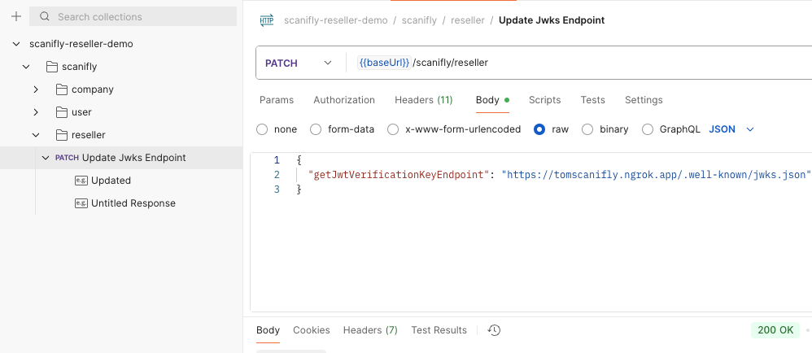

## Scanifly Reseller Demo Server

This is a NodeJS/Express HTTP server that will allow you to quickly test the Scanifly reseller APIs and see how to get your JWKS setup to be able to sign JWT's that Scanifly can then validate and use to authenticate your users into it's system.

## Setup & Running Locally

### Install Dependencies 
Clone the repository:
```bash
git clone git@github.com:Scanifly/reseller-demo-server.git
cd reseller-demo-server
```

### Postman

Inside the `app/routes/swagger.json` file is the openapi schema that you can import into Postman to easily test the APIs this server exposes.

### Setting Up Environment Variables

Copy the environment variable template file from `_env` to `.env`

```bash
cp _env .env
```

If you do not already have a JWKS you can generate one for testing [here](https://jwkset.com/generate)

Place your private key in the `JWKS_PRIVATE_KEY` field in the .env.

Take the public key and put it in the `/app/jwks.json` file inside the `keys` array.

Your JWKS algorithm must be RS256.

Place your key ID in the `JWKS_KEY_ID` field in the .env

The `SCANIFLY_EMAIL` and `SCANIFLY_PASSWORD` values in your .env must be the `admin` of your Scanifly account so that in can interact with the reseller APIs.

### Running Locally

####
This app is dockerized and can be run in a container by using the commands in the Makefile

```bash
make build-up
```

Alternatively if you want to modify the code and see your changes in real time you can run it locally with nodemon.

#### Prerequisites
- **Node.js** (v18+ recommended)
- **Yarn** (this repo uses Yarn 3.6.4)

If you don’t already have Yarn:
```bash
npm install -g yarn
```

To run the code locally with nodemon:

```bash
yarn install && yarn local
```
#### Configuring JWKS Validation

Scanifly needs to know the endpoint to reach out to validate a JWT against your JWKS public key.

That endpoint must be accessible via HTTPS.

A quick way to serve up this local node server via HTTPS is using [ngrok](https://ngrok.com/).

It does require a paid account to be able to serve via HTTPS.

Assuming you have a paid account and have a static domain on ngrok. 

On Mac you serve this demo server via that endpoint:
```bash
ngrok http --url=your_ngrok_domain 3001
```

Once you have your HTTPS URL you need to tell Scanifly to use that endpoint to validate your JWTs.

The PATCH scanifly/reseller endpoint can be used to accomplish that.



### Getting A 3D URL

If the user already has a companyId and userId you can skip to step 3.

1. Create a company in Scanifly
2. Create a user in Scanifly to associate with the company
3. Create a project in Scanifly for a given address
4. Create a design in Scanifly to associate with the project
5. Get a 3D URL